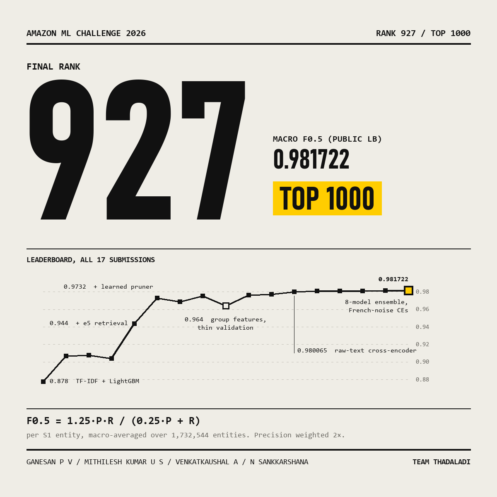
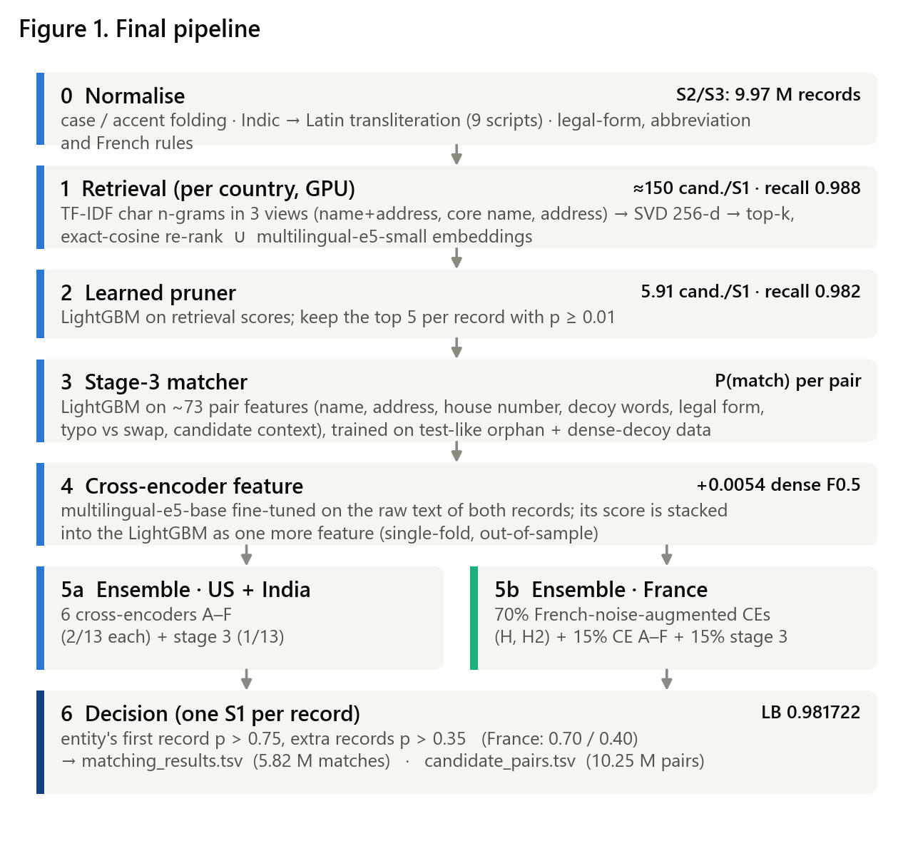
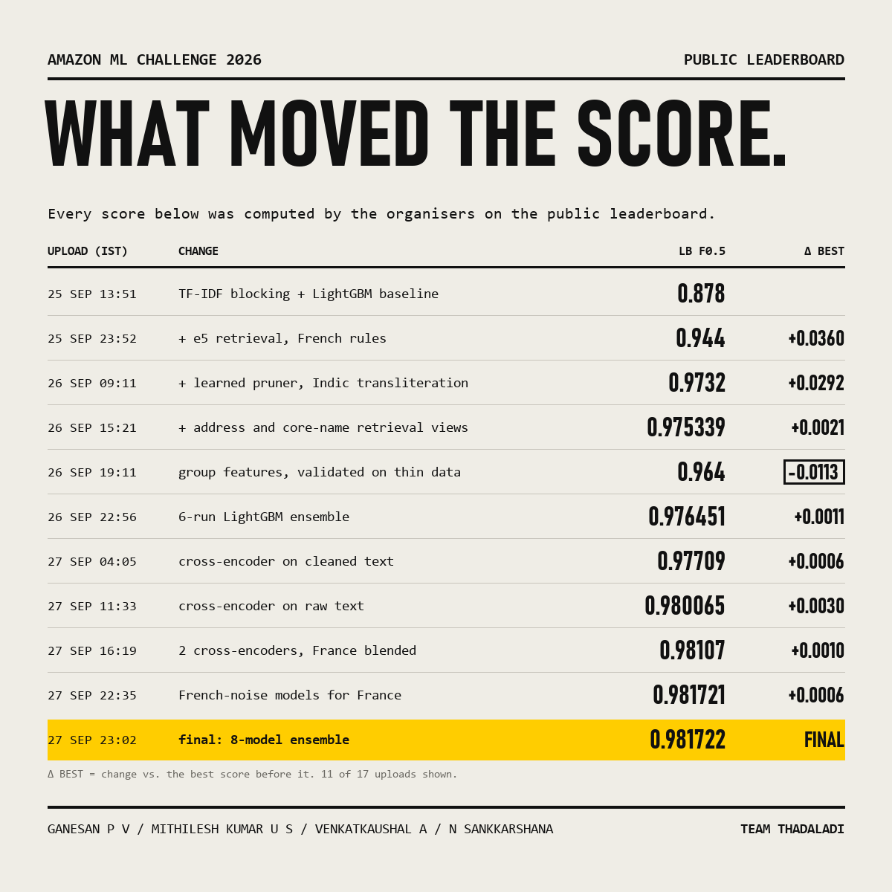

# Business Entity Resolution: Amazon ML Challenge 2026

Team **Thadaladi**'s solution to the Amazon ML Challenge 2026. The task: link millions of noisy business records
from two sources to a deduplicated reference list. The data spans the US, India and France, and France has no
training labels at all.

**Final public leaderboard: macro F0.5 = 0.981722, rank 927 (top 1000).**



## The problem

- **Source 1:** a deduplicated list of businesses (1.73M entities in the test set).
- **Sources 2 and 3:** ~10M noisy copies. They contain typos, abbreviations, moved legal forms, reordered
  addresses, Indic scripts, websites instead of names, and deliberately planted decoys.
- **Goal:** for every Source 1 entity, list the Source 2/3 records that are the same business. Each record
  belongs to at most one entity.
- **Metric:** F0.5 per entity, macro-averaged over all entities, which weights precision twice as much as recall:

  ```
  F0.5 = 1.25 · P · R / (0.25 · P + R)
  ```

## Approach



| Stage | What it does |
|---|---|
| 0. Normalise | Case/accent folding, our own transliteration for 9 Indic scripts, legal-form and abbreviation rules, French rules |
| 1. Retrieve | Per country: TF-IDF character n-grams in 3 views (name+address, core name, address) → SVD → GPU top-k, unioned with `multilingual-e5-small` embeddings |
| 2. Prune | A LightGBM model on the retrieval scores keeps the top 5 candidates per record. Final candidate set: **5.91 per entity** (10.2M pairs, out of 6.7 trillion same-country pairs) |
| 3. Match | LightGBM on ~73 pair features: name, address, house number, mined decoy words, legal-form conflicts, typo vs word swap, candidate context |
| 4. Cross-encoder | `multilingual-e5-base` fine-tuned on the **raw** text of both records; its score is stacked into the LightGBM as a feature |
| 5. Ensemble | US/India: 6 cross-encoders + the LightGBM. France: cross-encoders trained with French-style noise augmentation |
| 6. Decide | One entity per record. An entity's first record needs p > 0.75, extra records p > 0.35 (France 0.70 / 0.40) |

The full write-up, with all experiments, validation and what didn't work, is in
[`docs/METHODOLOGY.md`](docs/METHODOLOGY.md). A [PDF version](docs/METHODOLOGY.pdf) includes all 8 figures.

## What moved the score

Every number below is a public-leaderboard score.



Three things we'd tell anyone attempting this kind of problem:

1. **Make validation look like the test.** Our worst submission (−0.0113) came from a feature that looked great on
   a validation set with far fewer decoys than the real test.
2. **Give learned models raw text.** Normalisation helps hand-written features. But the legal forms, house numbers
   and extra words it removes are exactly what a cross-encoder uses to spot decoys.
3. **Labels aren't the only way to teach a model.** France had zero training rows. We added French-style noise
   (`& Fils` suffixes, dropped régions, shuffled addresses) to US/India training records instead.

## Repository layout

```
src/                 pipeline (entry points: v5_full.py, ce_stack.py, local_ensemble.py)
analysis/            French rule pruning, name-sharing study, error tagger (not part of inference)
docs/                METHODOLOGY.md / .pdf and figures
reproduce_final.sh   exact commands for the final submission
requirements.txt
```

## Running it

The competition data is **not included**. Get it from the challenge organisers and point the script at the folder
that contains `train/` and `test/`:

```bash
pip install -r requirements.txt
bash reproduce_final.sh /path/to/dataset
```

- **Steps 1–2 need a GPU** with 16 GB. We used free Kaggle and Colab T4/P100s, about 26 GPU-hours in total.
  The 8 cross-encoders are independent and can run in parallel.
- **Step 3** (blending and the decision rule) runs on a CPU in minutes. Run on our saved model outputs, it
  reproduces the submitted files byte for byte.

## Compliance

- Only the provided competition data. No external data, APIs, geocoding or hosted LLMs.
- Models: `intfloat/multilingual-e5-small` and `-base` (MIT), LightGBM (MIT), scikit-learn and PyTorch (BSD),
  transformers (Apache-2.0).

## Team

Ganesan P V · Mithilesh Kumar U S · Venkatkaushal A · N Sankkarshana

## License

MIT. See [LICENSE](LICENSE).
